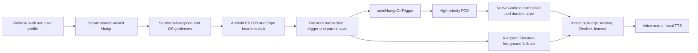

> Historical SDK52 audit. User subsequently approved hardening with emulators and unsigned artifacts. See [PRODUCTION_HARDENING_REPORT.md](PRODUCTION_HARDENING_REPORT.md) for 2026-10-31 implementation/evidence. Production remains undeployed.

# Nudgr — Final End-to-End Workflow Audit

**Audit date:** 30 October 2026 (Asia/Kolkata)  
**Repository baseline:** `04f9d3dac2465774cab712f89b26b257ef0bd274`, branch `main`, with pre-existing uncommitted work  
**Decision:** **FAIL — not ready for production release.** The audit and targeted local repairs are complete; the next development phase has not started.  
**New evidence:** `evidence/2026-10-30-final-workflow-audit/`  
**Release APK:** `Nudgr-V2/android/app/build/outputs/apk/release/app-release.apk`

## 1. Executive Summary

The sender-owned architecture is implemented and has an independently observed working path. On the newly built APK, an emulator sender generated an Android OS geofence ENTER, wrote a Firestore trigger, and caused the existing deployed Cloud Function to send FCM to the physical Vivo. The recipient displayed the incoming screen, accepted a real Answer tap, and displayed the Gentle message playback state. The Firestore event records one FCM acceptance and zero failures. This was a synthetic GPS test with one physical recipient, not a two-physical-phone field test.

The release build and Android release lint succeeded. All **34 Node tests** and **6 Firestore emulator checks** passed on their final runs. Two emulator checks intentionally demonstrate unresolved security vulnerabilities; their passing assertions are evidence that the vulnerabilities exist, not security approval.

Ten categories of genuine defects received targeted local fixes. The most serious were unsigned Firebase JWT acceptance, unauthenticated voice-media access, fail-open legacy voice authorization, overly broad recipient writes, and client-forgeable FCM status writes. **No Firebase functions, Firestore rules, Storage rules, or Cloudflare Worker were deployed.** Server-side repairs require a controlled, approved rollout and live verification.

Production remains blocked by private token exposure through shared profiles, connection authorization weaknesses, incomplete background and field verification, delivery retry/expiry gaps, debug release signing, target SDK 34, and native 16 KB compatibility failures. Current background retries stopped during emulator setup; they do not establish a delivery regression or a successful repeat.

### Workflow status table

Statuses apply to the evidence scope stated below. NOT TESTED means that the complete requested behavior was not actually verified; source inspection and mocked checks alone do not establish a full user journey.

| Module | Status | Evidence |
|---|---|---|
| Authentication | NOT TESTED | Existing test account successfully authenticated against Firebase; name repair and logout ordering pass behavioral tests. Fresh signup, account switching, and complete UI logout/login were not exercised on devices. |
| Nudgr creation | NOT TESTED | Validation and recipient/location guard pass tests; real audit fixtures were created through authenticated Firestore REST. The complete creation/voice upload UI was not submitted during this audit. |
| Sender geofencing | PASS | Current APK: emulator OS ENTER, sender-only registration logs, live trigger `trig_66b7f1b922a6f0e1`. Scope: synthetic GPS, foreground scenario. |
| Background execution | NOT TESTED | Historical native background evidence reviewed. Current minimized, removed-task, and killed-process runs failed in setup before the entry stimulus. Reboot-trigger continuity and long Doze were not verified. |
| Firestore | PASS | Current sender transaction produced a real trigger; local Firestore emulator verified ownership, immutable identities, completion/pause, and event write restrictions. This is not certification of all production rules. |
| Cloud Functions | PASS | Existing deployed trigger function produced `FCM_SENT`, one acceptance, zero failures for the new fixture; existing backend regression cases pass. New legacy voice Function fixes are not deployed or live-verified. |
| FCM delivery | PASS | Current physical Vivo foreground receipt correlates with the actual trigger ID and server acceptance. Closed-process delivery of this APK was not repeated successfully. |
| Lock-screen call UI | NOT TESTED | Native implementation and historical physical incoming screen/OPEN logs support prior operation. No successful current-build locked-screen repeat. |
| Answer/Decline | NOT TESTED | Current foreground Answer and Gentle playback UI verified. Current Decline and timeout were not reached; historical Decline artifacts have evidence gaps. |
| Security rules | FAIL | Local repairs pass emulator checks, but connected peers still read profile token maps and arbitrary known UIDs can be connected without a code proof. Repairs remain undeployed. |
| Android release build | PASS | `:app:assembleRelease :app:lintRelease` succeeded; 0 lint errors, 48 warnings. APK uses the Android debug certificate and is not suitable for store release. |

## 2. Complete Architecture Overview

Actual package versions are **Expo 52.0.35, React Native 0.76.9, React 18.3.1, React Native Firebase 21.14.0, expo-location 18.0.10, expo-task-manager 12.0.6, expo-notifications 0.29.14, and expo-av 15.0.2**. Older memory describing RN 0.76.7 is stale. Functions target Node 22 and use the modular Firebase Admin SDK. Android uses Hermes, the existing architecture, compile SDK 35, target SDK 34, minimum SDK 24, and NDK 26.1.



The production app entry resolves through Expo's `AppEntry.js` and `App.js`; the root `index.js` is not the configured package main. `App.js` imports the geofence task and registers the FCM background handler at module scope. Android `MainApplication` registers the existing `NudgrNativePackage`.

Data model:

| Path | Purpose and authority |
|---|---|
| `users/{uid}` | Profile, connection code, current `fcmTokens` map. Owner writes; connected-peer reads expose the whole document. |
| `connectionCodes/{code}` | Reverse code-to-UID lookup, readable by authenticated users. |
| `connections/{sortedUidPair}` | Canonical bilateral membership record. |
| `users/{uid}/connections/{peerUid}` | Per-user mirror used for subscriptions and profile authorization. |
| `users/{uid}/devices/{deviceId}` | Owner-only rules exist; the active token writer does not use this collection. |
| `nudges/{id}` | Sender/recipient identities, message, coordinates, radius, schedule, voice settings, enable/disable controls, timestamps and status. |
| `nudges/{id}/triggerEvents/{triggerId}` | Trigger coordinates/timestamps and backend FCM outcome counts. |
| R2 `voice/{senderUid}/{file}.m4a` | Recorded audio through the Cloudflare Worker. Firebase Storage is not the active voice path. |

Relevant source reviewed covers `App.js`, DB/auth/FCM modules, all geofence modules, notification and incoming-state modules, incoming UI, creation/auth/radius controls, management/navigation behavior, recorder/TTS/playback/R2 client, Functions, Worker, Android Kotlin components, manifests/Gradle, Firebase/index configuration, existing tests, previous reports and evidence. Layout/theme files were preserved. Graphify was queried before scoped source inspection and updated with AST-only extraction after changes. Its parser reports incomplete Gradle extraction; actual Gradle/source and the successful build remain authoritative.

## 3. Authentication Workflow

`AuthScreen.js` uses Firebase email/password signup and login. Signup rejects an empty trimmed display name before invoking Firebase. `ensureUserProfile` creates/repairs the profile and reverse connection code. Native Firebase supplies session persistence; `App.js` restores its session through the auth observer, then initializes profile, token, geofence, recipient, connection and alarm listeners.

Confirmed defects and repairs:

- Firebase's auth observer may run before signup's `updateProfile`. The profile helper now reconciles a nonempty Auth display name, avoids writing a null name over a populated profile, and signup calls it after `updateProfile` completes.
- Logout previously attempted owner-only token removal after `signOut`, when the write could be denied. The explicit logout action now awaits token removal while authenticated.

Token registration and refresh write the nested map expected by the backend. Multiple token entries support multiple recipient devices. Invalid token cleanup is implemented on the server. Token refresh can leave prior entries until cleanup; there is no per-device ownership migration or token-age cleanup.

Remaining limits: removal remains best effort when offline; fresh signup and account switching were not tested on a device. Profile/code creation is a sequence of separate writes rather than one atomic operation. Mandatory display name is a signup UI requirement, not a server-enforced invariant or a migration for legacy accounts. Async session initialization/imports can outlive a logout; the session/listener lifecycle needs dedicated account-switch testing.

## 4. Nudgr Creation Workflow

The recipient picker uses connected profiles. The location control captures the sender's **current location**; the implementation does not offer an arbitrary map/address destination picker. The radius slider clamps **2.5–10.0 km**, defaults to 5 km, and uses 0.1 km steps. The DB stores `radiusKm`, and native registration converts it to metres using `radiusKm * 1000`.

Creation validates authentication, non-self recipient, text message, and geometry. The audit added rejection of nonfinite/out-of-range latitude, longitude and radius. Bounds and valid radius endpoints pass tests. Server rules still need comprehensive payload/schema/rate validation.

Schedules include local after-hour/minute and a future `activeAfter` time. Text is required even when a voice note is attached. Voice recording is capped at 60 seconds, uses microphone permission, supports preview/discard, and offers TTS fallback on upload failure. Styles include Gentle, Normal, Energetic, Urgent and no message voice. “No voice” controls message playback; the incoming call alert can still ring.

A confirmed routing defect allowed a real recipient plus a schedule but no location to enter the local self-test branch. Real recipients now receive a location validation error; the explicit Self / Time Test path remains available.

Real Firestore creation was exercised using authenticated audit fixtures. Full UI creation, microphone recording, actual voice upload/download and arbitrary destination selection were not verified in this audit. The latter is not implemented and was not added.

## 5. Sender Geofencing Workflow

`startTriggerEngine` subscribes to **sent** Nudgrs, filters sender UID, active/scheduled status, enabled state and geometry, then registers OS regions. `registerGeofencesForNudges` independently rejects non-sender candidates. The recipient subscription does not register the sender's geofence. An account signed in on multiple sender devices can register its sent Nudgrs on each; there is no unique originating-device assignment.

This is an actual Android geofence implementation: the installed Expo native consumer calls `LocationServices.getGeofencingClient`, `addGeofences` and `removeGeofences`. Region identifiers are `nudgr-{nudgeId}`. Registered candidates and sender UID are cached in AsyncStorage for headless evaluation.

ENTER evaluation merges sender cache and Firestore, checks status, enabled state, schedule and distance, then calls `createTriggerEvent`. That function uses a deterministic event ID, a Firestore transaction, a parent last-trigger timestamp and a 30-minute cooldown. The audit added a live-document check inside the transaction so stale cached ENTER work cannot trigger a paused, cancelled, completed, wrong-owner or mismatched-recipient record.

Current build evidence: `audit-current-foreground-1793376874505`, region-specific registration, Android ENTER, and trigger `trig_66b7f1b922a6f0e1`. Synthetic GPS was used. Multiple fences are supported in source; their full device-scale behavior was not tested.

Limits: Android permits at most 100 geofences per app/device user; this code has no explicit capacity strategy. Registration diagnostics do not await a Play Services success callback independently of Expo's task registration. Fences are stopped and re-registered on relevant snapshots. Distance evaluation adds GPS-accuracy/50–150 m tolerance; fallback region-center coordinates do not establish a precise measured device location. No high-precision field boundary study was performed. [Android geofencing documentation](https://developer.android.com/develop/sensors-and-location/location/geofencing)

## 6. Background Execution Workflow

`TaskManager.defineTask('NUDGR_GEOFENCE_ENTER', ...)` is registered at module scope. Expo's native receiver/job service restores task definitions and starts headless JS. The handler initializes/accesses native Firebase, resolves persisted sender identity, reads cached/fresh Nudgrs and writes an online Firestore transaction. Cached configuration does not make an offline transaction durable or provide a retry queue for a missed ENTER.

The installed TaskManager manifest includes `BOOT_COMPLETED` and `MY_PACKAGE_REPLACED`; `TaskService` restores persisted tasks. These source paths support restoration, but an actual configured-fence ENTER after reboot was **not verified**. Cold-booting the emulator during recovery is not that acceptance test.

| Requested state | Current audit result | Prior evidence and qualification |
|---|---|---|
| Foreground | PASS | New APK, synthetic sender GPS, real Vivo recipient and Answer. |
| Minimized | NOT TESTED | Retry reached registration, then `dumpsys package` timed out before precondition capture and entry. Historical minimized evidence exists. |
| Removed from Recents | NOT TESTED | Retry failed during emulator location setup. Historical removal logs show tasks absent and `stopped=false`; removal used `am stack remove`, not a recorded finger swipe. |
| Process killed without force-stop | NOT TESTED | Retry failed during emulator location setup. Historical cold-process receipt logs were reviewed. |
| Screen off and locked | NOT TESTED | No completed current-build background repeat. Historical physical full-screen OPEN/incoming screen evidence exists. |
| Reboot with configured geofence | NOT TESTED | Native restoration code reviewed; emulator recovery reboot did not verify delivery continuity. |

No force-stop was used in this audit. Background setup failures and the first stalled emulator installation are retained. All created audit fixtures were cancelled. Existing battery-exemption entries were observed on both devices; successful evidence must not be generalized to default OEM power settings, long Doze, or devices without those exemptions.

## 7. Firebase and FCM Workflow

Sender transactions create `CREATED` trigger events and mark the parent Nudgr `triggered`. The Firestore `sendNudgeOnTrigger` on-create function atomically claims the live event as `FCM_SENDING`, reads the recipient profile map, sends to its tokens, and records success/failure counts. `updateNudgeOnTrigger` separately updates parent trigger state and avoids reprocessing triggered/completed parents.

The payload includes notification plus data, nudge/trigger/sender/recipient identities, sender name and message, Android high priority, channel `nudgr_calls_v3`, ringtone, vibration settings and a stable `nudgr_{id}` tag. Native handling supplies the full-screen intent and action buttons. FCM acceptance is recorded **after** the SDK send result, with failure when all tokens fail. Missing recipients/tokens and send errors become `FCM_FAILED`; expired/invalid registration tokens are removed best effort without overwriting an accepted outcome.

`FCM_SENT` means **accepted by FCM**, not delivered/displayed/heard. Parent `triggered` can precede FCM success and is not proof of delivery. Answer/Decline/missed state is primarily local/native; it is not a complete backend receipt history.

The at-most-once claim prevents simultaneous/replayed event sends but has no lease recovery. A crash after the claim can strand `FCM_SENDING`; caught send failures are not automatically retried by application code. No expiry/short Android TTL, 500-token batching, durable offline trigger queue, recipient delivery acknowledgement, or scheduled repair job is present. These were documented, not introduced as new features. Firestore event delivery itself can repeat, so recovery must preserve idempotency. [Firestore event semantics](https://firebase.google.com/docs/functions/firestore-events), [retry behavior](https://firebase.google.com/docs/functions/retries), [FCM lifespan](https://firebase.google.com/docs/cloud-messaging/customize-messages/setting-message-lifespan)

Current live event: creation `2026-10-30T16:15:27.831Z`, FCM acceptance `16:15:35.040Z`, one success and zero failures. Correlated device logs establish recipient receipt separately.

## 8. Recipient Incoming Call Workflow

`NudgrFirebaseMessagingService` handles background native delivery before React is ready. The synchronized native helper creates the existing v3 channel, checks app/channel notification permission and Android full-screen capability, posts one stable tag/id with Answer/Decline, uses an immutable explicit PendingIntent, and applies a 30-second timeout plus repeating alert flag. Default Firebase auto-display is suppressed after native handling to avoid overwriting the call actions.

`NudgrIncomingState` persists ringing/terminal state in SharedPreferences. JS state consults that durable state and preserves cold Decline/Answer outcomes. Foreground Firestore and FCM paths share deduplication with the native poster. `MainActivity` retains ringing on OPEN until foreground AV starts; Answer enters answered mode and cancels the native alert. Decline is handled by the native receiver; the React incoming UI also provides Answer, Decline, replay, stop and finish.

Current physical verification: incoming React screen, real Answer tap at `(891, 2405)`, connected message, and **Gentle / Playing** display. Audio-manager and vibration-history extracts were captured. These records and the UI do not establish human-confirmed audibility, perceptual voice quality, or current tactile vibration. The foreground notification had already been handed off/dismissed when its notification dump was taken; the empty dump is not presented as evidence of an active native call.

Source shows cleanup on answer/decline/timeout/unmount: stop ringtone, cancel vibration, dismiss the notification and stop message playback. Existing regressions cover cold actions, terminal-state replay suppression, native/Expo deduplication and ringtone resource loading. Current closed-process Decline and timeout could not be completed.

Remaining risks from source inspection: incoming UI keeps component-local refs/state across a change of nudge ID; overlapping calls need explicit lifecycle tests. An async voice download/load can finish after stop/unmount unless pending playback is cancelled. Native incoming presentation does not validate the current account against the payload recipient, and `MainActivity` applies lock-screen visibility broadly. These need coordinated hardening with regression/device coverage.

Full-screen permission is checked at runtime, but declaration/category alone does not grant Play eligibility. Android 14+ limits default full-screen access to qualifying calling/alarm use cases; user permission and device state affect presentation. Permission-denied behavior and dedicated Android 14/15 devices were not tested. [Android full-screen restrictions](https://developer.android.com/about/versions/14/behavior-changes-14#secure-fsi-notifications)

## 9. Security Audit

| Finding | Severity | Result |
|---|---|---|
| Worker trusted decoded JWT claims without cryptographic signature verification | Critical | Locally fixed: RS256/JWK verification and required issuer/audience/time/subject claims; forged-token tests now reject. |
| Worker media route had no authentication or participant/object authorization | Critical | Locally fixed: bearer header, Firestore participant check, exact voice key and sender namespace checks on URL preparation and media access; no bearer token in URLs. |
| Worker uploads could write another user's namespace; MIME and actual body length were not enforced | High | Locally fixed: owner namespace, allowed types and streaming-read byte limit before R2 write. |
| Legacy R2 Functions used incompatible Admin namespaces and allowed missing nudge/auth lookup failures to fall through | Critical | Locally fixed with modular SDK, mandatory existing document, participant and exact sender-owned key, fail-closed lookup failure. |
| Recipient could alter unrelated parent fields when resulting status was triggered/completed | High | Local rules restrict changed fields and completion transition; emulator denial confirmed. |
| Sender could alter trigger identity or write/re-arm FCM transport statuses | High | Local rules permit only restricted terminal status/timestamp updates; forged FCM success is denied. |
| Connected peers read the entire `users/{uid}.fcmTokens` map | High | **Unresolved, reproduced in emulator.** Firestore rules cannot hide individual fields in an otherwise readable profile. Needs coordinated private token storage/backend/client migration. |
| Canonical connection creation requires pair membership but no proof of the peer's code/consent | High | **Unresolved, reproduced in emulator.** A client knowing another UID can create the pair and mirrors, gaining profile access. |
| Nudgr creation lacks connection enforcement and comprehensive server geometry/schema/rate limits | High | Unresolved server authorization/abuse gap; UI validation is not a security boundary. |
| Native account/recipient validation and broad lock-screen visibility | High | Source risk requiring lifecycle/privacy hardening and device tests. |
| Release logs contain coordinates, identities and message payloads | Medium | Source exposure remains; captured audit logs use fixture data and redact token/credential lines. |

The new Worker and legacy Function protections remain local. Hosted protected voice access was not tested against a deployed patched revision. Token and connection weaknesses mean the security assessment remains FAIL even after the local fixes.

The current tracked-file pattern scan found no private key, service-account key, AWS access key or GitHub token. It found Firebase client API identifiers in the two Google Services configurations; values were redacted. These identifiers are normally public project/app configuration, with access controlled by rules/IAM/App Check. Actual API restrictions and App Check enforcement were not inspected in the cloud console. The scan is not a full historical entropy audit. A sensitive-filename Git-history query returned no matching secret/signing paths. [Firebase API-key guidance](https://firebase.google.com/docs/projects/api-keys)

R2 secrets are server environment variables in source, not embedded credentials. Test-account credentials and tools remain in ignored `tmp_check`; no secret was added to the report or committed. `storage.rules` is a dormant legacy Firebase Storage path, is not configured in `firebase.json`, and was not compiled/deployed/tested in this audit.

## 10. Testing Results

| Check | Result | Evidence |
|---|---|---|
| Existing regression baseline | PASS, 21/21 | `baseline-fcm-tests.txt` |
| Final Node regressions | PASS, 34/34: original 21 plus 13 audit cases | `node-regressions-complete.txt` |
| Defect reproduction against Git baseline | Expected failure, 11/11 original audit cases fail before fixes | `baseline-defect-reproduction-final.txt`; UI follow-up cases have additional final behavioral coverage. |
| Firestore rules integration, local Java emulator | PASS, 6/6 checks | `rules-final-restored-run.txt`; includes two explicit unresolved-vulnerability demonstrations. |
| Original rules reproduction | Expected failure, 2 denial cases fail on original rules | `baseline-rules-defect-reproduction.txt`; audited local rules restored afterward. |
| First rules run | 5/6, first request timed out during emulator cold initialization | `firestore-rules-tests.txt`; timeout allowance corrected and subsequent restored-rules runs passed. |
| Functions ESLint | PASS | `functions-lint-final.txt` |
| App JS/JSX parsing | PASS | Included in existing regression suite; Worker and Functions also evaluated/parsed by audit tests. |
| TypeScript project check | NOT TESTED / unconfigured | `tsc --noEmit` exited 1 with usage output: no project tsconfig or application TS source project. `typescript-check.txt`. |
| Frontend lint | NOT TESTED / unconfigured | No app lint script/configuration; Functions lint is separate. |
| Android compilation, bundling and APK assembly | PASS | `android-release-build.txt`, `BUILD SUCCESSFUL in 7m 35s`. |
| Android release lint | PASS with warnings | 0 errors, 48 warnings; native report `android/app/build/reports/lint-results-release.txt`. |
| APK signature | PASS for integrity, FAIL for production identity | `apk-signature.txt`: Android Debug certificate. |
| ZIP 16 KB alignment | PASS | `apk-zipalign-16kb.txt`. |
| ARM64 ELF 16 KB alignment | FAIL | 13/14 libraries have sub-16 KB load segments; `apk-16kb-elf-audit.json`. No 16 KB device execution. |
| Current physical-recipient foreground path | PASS, limited scenario | `device-repeat-2/foreground-result.json`, screenshots and sender/recipient logs. |
| Current background device runs | NOT TESTED after setup failures | `device-repeat-2/verified-scenario-summary.json` and execution log. |
| Full hosted voice / Firebase Auth UI / real GPS field integration | NOT TESTED | No successful current device cases for these flows. |
| Existing user-change preservation | PASS, all 16 baseline paths | `user-change-preservation.json`; touched files match baseline exactly after removing only the audit's small additions. |
| Git whitespace check | Existing failure preserved | `.gitignore:37` pre-existing extra EOF blank line; no unrelated cleanup. `diff-check.txt`. |

The first device setup was interrupted because emulator package/location Binder calls stalled. The installation retry hit `INSTALL_FAILED_DUPLICATE_PACKAGE`; cold boot completed the pending installation. A fresh run then verified foreground delivery on matching APKs. Later background setup calls timed out. The device evidence harness also had a stream-close error after recording those results; its close handling was repaired. None of these setup/harness failures was relabeled as a passing app scenario.

The same AVD was restarted with `-no-window -no-snapshot-load`, preserving its user data. Emulator-only shell mock-location access and GPS/network test providers were configured for synthetic testing. The physical phone's power exemptions were not changed. The local Firestore emulator was used only on loopback with the demo project and was stopped after verification.

Reproduction commands:

```powershell
cd 'E:\work\App -V2\Nudgr-V2'
node --test tests/fcm-regression.test.cjs tests/workflow-audit.test.cjs
npm.cmd --prefix functions run lint
# Start the local Firestore emulator with firestore.rules on 127.0.0.1:8087 first:
$env:FIRESTORE_EMULATOR_HOST = '127.0.0.1:8087'
node --test tests/firestore-audit.test.cjs
cd android
.\gradlew.bat :app:assembleRelease :app:lintRelease --no-daemon --max-workers=2 --console=plain
```

APK SHA-256: `79835ee97409eda0e5141980b30da180396965bd5d90bf706a914f4abe9937d3`. Both device precondition records contain this installed hash. App source was unchanged after this build; later refinements affected server-side voice authorization and audit tooling/tests only. No commit, branch reset, destructive Git operation or deployment was performed.

## 11. Physical Device Verification

### Devices and scope

- Sender: `emulator-5554`, `Medium_Phone_API_37.0`, Android API 37, synthetic GPS.
- Recipient: physical Vivo I2304, `10BE1X1ZC20003G`, **Android 16 / API 36**, independently queried. The old handoff's Android 15 label is inaccurate for the connected device.
- One physical phone was available. **Two physical phones entering an actual configured GPS geofence were NOT TESTED.** Current subjective audible ringtone/vibration confirmation was not obtained.

### New successful foreground case

Fixture `audit-current-foreground-1793376874505` produced `trig_66b7f1b922a6f0e1`. Both devices were awake, running the same audited APK, with `stopped=false`. Sender registration and an Android OS ENTER were observed; the server event records one FCM acceptance. Vivo foreground receipt, ringing incoming screen, Answer tap and Gentle playback UI were recorded. Native/JS notifications were cancelled during handoff/Answer. See `device-repeat-2/foreground-*`.

### Requested historical case

`audit-both-off-1793371166490` was independently located in original UTF-16 sender/recipient logs, the saved result, and current read-only Firestore queries. Trigger `trig_ed40d68d9dace04d` records creation at `2026-10-30T14:40:01.272Z`, FCM acceptance at `14:40:08.820Z`, one success and zero failures. Recipient logs show native receive, call post with full-screen capability, and actual MainActivity OPEN. Its saved result reports recipient wakefulness still `Asleep`, despite asserting a pass. The test setup minimized the sender, rather than proving both tasks were absent from Recents. Therefore it supports historical background transport, not the entire strict two-phone acceptance condition.

### Numbered latest evidence

The seven files in `evidence/` and `Nudgr-V2/evidence/` have identical matching copies; hashes were recorded and the originals preserved. They refer to the later case **`audit-twophone-final-1793374089134`**, not the requested earlier ID. Its live trigger `trig_a5690989cc796e6d` now records FCM_SENT with one acceptance; the rendered `05_firebase_trigger_record.png` captured only CREATED before the backend update.

The numbered log explicitly configures battery exemptions/unrestricted execution, removes tasks with `am stack remove`, and records `stopped=false`. It contains physical incoming-screen evidence, but its summary reports **vibrator state verified: false** and an asleep recipient wakefulness during the claimed alert. The MP4 is about **10.81 seconds**, with video/data streams and **no audio stream**. It cannot establish audible ringtone. The log records an Answer-coordinate tap, which alone does not prove a successful answer transition.

Other historical limitations: scenario-3 ringing/declined PNGs are byte-identical; its JSON `declined:true` is not independent visual proof. Reviewed native lines show receive/post/OPEN/cancellation, which can also occur during foreground ringing handoff. An older October 8–9 report separately records human ringtone/vibration/Answer confirmation for its own APK; that historical confirmation does not certify this build or every scenario.

## 12. Bugs Found and Fixes

| Root cause | Minimum applied change | Regression evidence |
|---|---|---|
| JWT payload decode treated as authentication; voice media was public | Verify Firebase RS256 signatures/claims, authenticate media with headers, bind access to participant/document/key/sender, enforce upload owner/type/size | Cryptographic positive/negative Worker tests, authorized playback response and denied foreign media/oversize writes |
| Legacy voice APIs used removed SDK namespaces and failed open on authorization errors | Modular Auth/Firestore APIs; reject absent/wrong documents, users and keys; fail closed on lookup errors | Legacy Function failure-path tests; Functions lint |
| Recipient status branch bypassed field restrictions | Require recipient changed-field allowlist and completion-only status transition | Real Firestore emulator completion/pause successes and tampering denial |
| Clients could forge FCM statuses or edit event identity | Restrict client trigger updates to terminal state/timestamp fields | Emulator rejects FCM_SENT and identity changes |
| Token removal happened after logout revoked write authority | Await token removal before Firebase signOut | Behavioral logout sequencing test |
| Signup auth observer could persist a null/stale display name | Reconcile nonempty name after Auth profile update; prevent null overwrite | Profile repair test and app parsing/build |
| UTC date strings disagreed with local pause boundary | Use a local calendar key for pause reads/writes | Asia/Kolkata midnight regression |
| Numeric type checks accepted invalid geometry | Finite latitude/longitude bounds and 2.5–10 km service validation | Endpoint acceptance and invalid/NaN/Infinity rejection tests |
| Cached evaluation raced live pause/cancel/ownership changes | Recheck live sender/state/schedule/recipient in trigger transaction | Stale-state transaction denial tests; current live foreground trigger |
| Recipient scheduling without location silently became a local test | Limit local test branch to explicit self-test recipient; reject missing location for peers | UI handler behavioral regression |

Modified application/server source: `App.js`, `firestore.rules`, `functions/r2.js`, `src/db/{nudges,triggers,users}.js`, `src/ui/{AuthScreen,CreateNudgeScreen}.js`, `src/voice/{playback,r2Storage}.js`, `worker/index.js`. Two new test files and isolated audit evidence/tooling were added. UI layout, theme, native call implementation, FCM channel, sender ownership and existing features were preserved. Hash comparisons confirm all prior user edits were retained.

## 13. Remaining Limitations

- Production rollout and verification of patched rules, Functions voice handlers and Worker are outstanding; hosted revisions were not certified.
- Shared profile tokens, code-free connection creation, weak server payload/recipient checks and native account/lock-screen privacy remain security blockers.
- Delivery claims lack crash recovery, bounded expiry, device receipt history and transient/offline recovery; more than 500 accumulated tokens are not batched.
- Current closed/minimized/locked/timeout/Decline paths, long Doze, high-precision boundary accuracy, battery drain, multiple fences/devices and actual two-phone physical movement require repeatable verification.
- The UI supports current-location selection only. Scheduled activation while already inside a fence and “today only” re-enabling while the app remains closed have no dedicated clock-driven remote trigger evaluation. Sender-side local alarms are separate from recipient delivery.
- Multiple incoming IDs, pending audio cancellation, account-switch session cleanup and listener lifetime need explicit tests and conservative repairs. The new foreground trace also contains duplicate FCM callbacks, although no second incoming alert was observed.
- Management displays completed enabled Nudgrs as ON, while the geofence engine only monitors active/scheduled records. Product semantics for re-arming/history need clarification. Trigger records exist in Firestore; the detail UI does not implement a full per-trigger delivery history.
- Complete permission-denied UX, arbitrary destination selection, fresh signup UI, full voice-note integration, accessibility and back-navigation coverage were not completed on devices.
- Android 14/15-specific physical tests, iOS builds and iOS incoming behavior are unverified. iOS Firebase/native distribution configuration is not established by this Android audit.
- No frontend lint/type-check project, automated device CI, production signing or verified store release workflow exists in the inspected configuration.

## 14. Production Readiness Assessment

**Overall: FAIL for production release.** There is a working core Android path and a usable test APK, with clear evidence for the current foreground sender-to-recipient workflow. That is sufficient to plan a hardening phase, not to certify the full acceptance matrix.

Release-specific blockers are independently measurable: debug certificate, target SDK 34 against the current Google Play API 36 submission requirement, and 13/14 ARM64 ELF libraries below 16 KB load alignment. ZIP alignment passing does not establish native runtime compatibility. A release AAB, signing ownership, version strategy, privacy/data-safety/background-location declarations, full-screen/exact-alarm eligibility, crash monitoring and distribution validation remain outstanding. [Current target-SDK requirement](https://developer.android.com/google/play/requirements/target-sdk), [16 KB support guidance](https://developer.android.com/guide/practices/page-sizes)

Acceptance must require verified security boundaries plus actual locked-screen, no-force-stop delivery on two physical devices with measured ringtone/vibration, Answer, Decline and timeout, and honest failure/expiry records. Default power settings and supported OEM exceptions must be stated separately.

## 15. Next Development Phase

The recommended next phase is **production hardening and acceptance verification**. It has not been started and requires user approval.

1. **Close security and privacy gaps, then approve a staged backend rollout.** Move tokens to private per-device storage with a compatible backend/client migration; require valid connection authorization; validate recipients and payloads; scope native lock-screen/account access; deploy the reviewed voice/rules repairs with rollback and authenticated live tests.
2. **Make delivery recoverable and observable.** Add a recoverable send claim, bounded retry/expiry and offline handling, token batching/aging, and separate acceptance/device/answer/decline/missed outcomes without duplicate calls.
3. **Complete physical background acceptance and battery testing.** Stabilize the test environment, use two real phones with real GPS, test all lifecycle/reboot/Doze/OEM states, multiple Nudgrs and both power policies; capture current APK provenance, real action transitions, audio/vibration and timing.
4. **Repair and verify lifecycle, scheduling and management UX.** Test account switching/listener cleanup, overlapping incoming IDs and cancelled audio loads; resolve closed-app scheduled/day reactivation and completed/re-arm/history semantics; improve permission/error/back-navigation coverage while preserving the existing design. Keep the previously requested theme-transition and precision checks in this queue.
5. **Prepare the supported release toolchain and distribution.** Plan the Expo/RN/NDK/API upgrade for API 36 and 16 KB devices; configure production signing and AAB/versioning; establish meaningful lint/type/test/device CI, crash monitoring and Play policy/distribution checks.

Core implemented features to retain are sender-owned OS geofences, transactional triggers, backend FCM routing, the native v3 call notification and cold action state, existing voice recording/TTS styles, enable/pause controls and current visual design. No new feature phase, architectural replacement or production deployment is authorized by completion of this audit.
